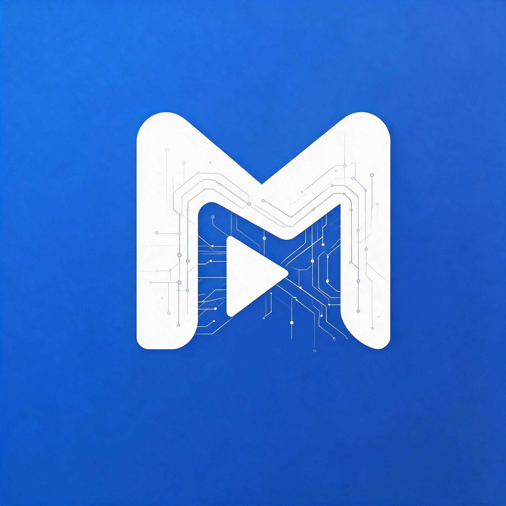
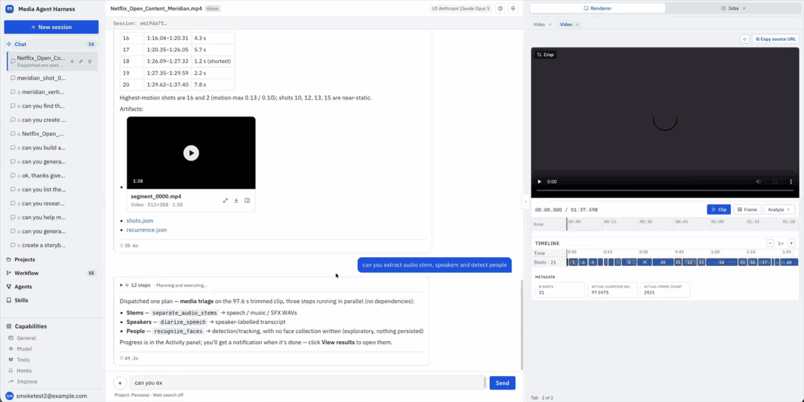

<div align="center">
  <div>
    
  </div>

  <h1>
    Media Agent Harness
  </h1>

  <h2>
    A shared operating layer for media agents on AWS.
  </h2>

  <div align="center">
    <a href="LICENSE"></a>
    <a href="https://aws.amazon.com/bedrock/agentcore/"></a>
    <a href="https://strandsagents.com"></a>
    
    
    
  </div>

  <p>
    <a href="#quick-start">Deploy</a>
    ◆ <a href="#create-your-first-user-and-sign-in">First sign-in</a>
    ◆ <a href="#delete-the-deployment">Clean up</a>
    ◆ <a href="agent/skills">Skills</a>
  </p>
</div>

A harness is everything around a model that lets it act: the context to understand a task, the tools to do the work and the controls that govern it. General-purpose harnesses carry that context as text, because text is what their users work in. Media context doesn't fit in text, and it has to travel both ways. Into the agent go a frame-accurate in and out point, a region of the picture, a reference look, the waveform under a line of dialogue. Back to the person come the clip itself, a timeline with shot, speaker and caption lanes, and the new render beside its source. A text harness leaves that work to a second application and timecodes copied by hand.

Media Agent Harness keeps the operator, the agent and the media in one visual workspace, built on [Amazon Bedrock AgentCore](https://aws.amazon.com/bedrock/agentcore/) and [Strands Agents](https://strandsagents.com). Underneath, it moves media by reference, runs long jobs as [Unified Media Agent Toolkit](https://github.com/aws-samples/sample-unified-media-toolkit-on-aws) micro-workflows behind an AgentCore Gateway, plans multi-step work as a DAG of sub-agents, and answers from indexed projects with citations to the exact moment or page. Use it from the built-in workspace, or publish a custom agent and call it from any OIDC application.

<div align="center">
  
</div>

It runs on the **[Unified Media Agent Toolkit](https://github.com/aws-samples/sample-unified-media-toolkit-on-aws)**, a family of serverless media workflows (transcoding,
speech diarization, stem separation, shot segmentation, face recognition, hybrid search,
text-to-speech) that the harness calls as tools through an MCP gateway.

Using a coding agent? [`AGENTS.md`](AGENTS.md) (read by Claude Code through [`CLAUDE.md`](CLAUDE.md)) covers the deploy model, the test commands and the gotchas.

| Directory | Description |
|-----------|-------------|
| [`agent/`](agent/) | Strands agents (main orchestrator, task, planning, design, render), the Lab service, tools and built-in [skills](agent/skills/) — Python |
| [`ui/`](ui/) | React workspace (`src/`) and the authenticating proxy (`server/`) — TypeScript |
| [`infra/`](infra/) | AWS CDK app: AgentCore runtimes and gateway, the proxy, data stores, ingestion and search |

## Why Media Agent Harness

Give agents the platform media work needs. Keep every step governed.

- **Visual context, both ways.** Frame-accurate ranges, markers and crops go in from the timeline; clips, lanes and side-by-side renders come back in the Renderer. No second video tool, no timecodes typed by hand.
- **Media by reference.** Agents pass S3 locations and short stable links, never bytes or expiring URLs. Every output becomes a project asset with its lineage.
- **Long-running jobs.** Shot segmentation, diarization, transcoding and face recognition run as Unified Media Agent Toolkit jobs. A job registry tracks them, and results stream back to the chat when they finish.
- **Plans, not prompts.** Multi-step requests become a DAG that fans out, waits on jobs and hands results forward, so the work outlives the turn.
- **Governed capabilities.** Skills, tool collections, hooks and custom agents are versioned assets with a draft → publish lifecycle, discoverable through the AgentCore Agent Registry.
- **Grounded answers.** Projects are indexed for search across video, audio, images and documents, and every citation opens a preview at its range.

Build a harness of your own when your domain's context is hard to express as text and your users aren't developers. For media, both are true.

## Architecture


## Components

| Component | What it does |
|---|---|
| **Web workspace** | Chat with the agents, upload and browse media, review results in interactive viewers (video timeline, images, documents), and manage skills, agents and tools. Served through Amazon CloudFront; sign-in with Amazon Cognito. |
| **API proxy** | The workspace's backend on AWS Fargate. Validates every request, signs calls to the agents, and serves media through short-lived links — media is never publicly readable. |
| **Agents** (AgentCore Runtime) | An orchestrator that plans and delegates to specialist sub-agents: a task agent for tool-heavy work and code execution, a planning agent for multi-step jobs, a design agent for brainstorming, and a render agent that turns results into interactive views. |
| **Skills, tools and hooks** | Built-in and user-authored skills, tool collections and event-driven hooks, versioned and published through a lab workflow. Custom agents combine a persona, skills and tools, and can be exposed to external applications. |
| **Capability API** | An always-on Fargate service that serves the catalog of skills, agents and tools quickly, backed by Amazon DynamoDB and the AgentCore Agent Registry. |
| **Projects** | Shared workspaces for a team's media: membership-scoped access, automatic indexing of uploaded media, and search across it. |
| **Code sandbox** | AgentCore Code Interpreter for sandboxed Python, with per-project, per-session storage credentials. |
| **Media toolkit integration** | The harness connects to the toolkit's MCP gateway and tracks its long-running jobs to completion, so agents can start a job and pick up the result later. |

Everything is defined in AWS CDK (`infra/`) and deploys into your own AWS account.

## Quick Start

### Deploy the harness and the media toolkit (one command)

Prerequisites:

- [Bedrock model access](https://docs.aws.amazon.com/bedrock/latest/userguide/model-access.html) for Anthropic
  Claude in the target account.
- Git, Node.js 20+ and AWS credentials for the target account, for an identity that can create IAM roles.
  No Docker, no image tags, and no clone of the toolkit repo.
- One of the toolkit's published regions — `eu-west-1`, `us-east-1`, `us-west-2`, `ap-southeast-2` or
  `ap-northeast-1` (Tokyo).
  The deploy goes to the region your AWS CLI resolves, so **set it explicitly** (`AWS_REGION` wins
  over the profile's configured region).
- **About 160 free IAM roles** (89 for the toolkit, 71 for the harness). Accounts have a default quota
  of 1,000 roles; check before deploying, and raise it if needed (increases are usually approved
  automatically):

  ```bash
  aws iam list-roles --query 'length(Roles)'                        # roles in use
  aws service-quotas get-service-quota --service-code iam --quota-code L-FE177D64 \
    --region us-east-1 --query 'Quota.Value'                         # the quota
  aws service-quotas request-service-quota-increase --service-code iam \
    --quota-code L-FE177D64 --desired-value 1500 --region us-east-1  # if needed
  ```

```bash
git clone https://github.com/aws-samples/sample-media-agent-harness-on-aws.git
cd sample-media-agent-harness-on-aws
export AWS_REGION=us-west-2                                    # one of the five regions above
cd infra && npm ci
npx cdk bootstrap -c env=customer                               # once per account/region
npx cdk deploy -c env=customer --all --require-approval never
```

This deploys two stacks, in order:

1. **`mediaworks-harness-media-toolkit`** — the media toolkit, from its published, pre-built template
   (pinned in `infra/lib/toolkit/toolkit-release.ts`), as a nested stack, plus the
   S3 bucket the toolkit and the harness share for source media. Its 17 media workflows and the MCP
   gateway are nested stacks; a first create took about 12 minutes in our test.
2. **`mediaworks-harness-infra-customer`** — the harness. At deploy time it reads the toolkit's
   gateway URL, credentials secret (by ARN only — the client secret never leaves AWS Secrets Manager)
   and output bucket from the stack above, so there is nothing to copy between the two. It builds its
   own container images and web UI in CodeBuild, creates its Agent Registry, and creates a 2-AZ public
   VPC for its Fargate services (UI proxy and Capability API — the only VPC-attached resources).

The stacks are independent: a failed harness deploy rolls back only the harness — rerun the same
command and only the harness redeploys — and deleting the harness leaves the toolkit in place.

> [!IMPORTANT]
> This is sample code, not a production-ready service: review IAM, authentication and data handling before production
> use. It creates billable resources — Bedrock tokens and AgentCore usage, plus Fargate services and a load balancer
> that bill while idle. Remove them as described in [Delete the deployment](#delete-the-deployment); media buckets,
> image repositories and the user pool are retained on purpose.

Options (append to the `cdk deploy` line):

| Option | Effect |
|---|---|
| `-c projectName=<name>` | Prefix for every resource name (default `mediaworks-harness`). One install per name per account/region: a second install in the same account needs a different name, or its fixed resource names collide. |
| `-c toolkitStackName=<stack>` | Use a media toolkit stack you already deployed instead of deploying one; the harness reads its Outputs and credentials secret at deploy time. |
| `-c vpcId=<vpc-id>` | Use an existing VPC instead of creating one. It needs public subnets in at least two AZs; tasks get public IPs (no NAT). |

Video crop and reel assembly run ffmpeg in the code sandbox. The deploy builds that ffmpeg itself, in
AWS CodeBuild, from pinned and checksummed FFmpeg and OpenH264 sources: a static, LGPL-licensed
arm64 build (`--disable-gpl --disable-nonfree`, H.264 encoding through OpenH264). It stages the
binaries, their licence texts and the corresponding source archives under
`s3://<projectName>-skills-store-<account>-<region>/tools/ffmpeg/`, and the sandbox reads them with
its own IAM role. Nothing is served publicly: the artifacts CDN refuses every path, and other
consumers get short-lived presigned S3 URLs. The first deploy spends a few minutes on this build; later
deploys reuse it. The recipe is `infra/lib/distribution/ffmpeg/Dockerfile`.

### If the deploy fails

Only the stack that failed rolls back, so fix the cause and rerun the same command — a toolkit that
already reached `CREATE_COMPLETE` is not redeployed.

- **`ROLLBACK_FAILED` on `ConversationMemory`** (`Memory is in transitional state CREATING`): the
  harness failed while its AgentCore Memory was still being created, and AgentCore will not delete it
  until it finishes. Wait a minute or two, then delete the failed stack and rerun the deploy:
  `aws cloudformation delete-stack --stack-name <projectName>-infra-customer`.
- **`IncorrectDefaultCredentials: Need to perform AWS calls for account 100000000004`** (or any account
  that is not yours) on `cdk bootstrap` or `cdk deploy`: the command ran without `-c env=customer`, and
  older packages then defaulted to an internal environment. Rerun it with `-c env=customer`, or bootstrap
  explicitly with `npx cdk bootstrap aws://<your-account-id>/<region>`.
- **Resources left after a failed first create.** Some resources are kept on deletion by design (for
  example the Cognito user pool, a KMS key and the container image repositories). After a failed
  *first* create they are empty; remove them from the console or CLI if you are not retrying.

### Create your first user and sign in

Self-registration is disabled (users are created by an administrator), so a new deployment has no users. Create one with the
AWS CLI, using the same credentials and region you deployed with:

```bash
STACK=mediaworks-harness-infra-customer        # <projectName>-infra-<env>
EMAIL=you@example.com
out() { aws cloudformation describe-stacks --stack-name "$STACK" \
  --query "Stacks[0].Outputs[?OutputKey=='$1'].OutputValue" --output text; }
POOL_ID=$(out UserPoolId)

# Creates the user and emails them a temporary password.
aws cognito-idp admin-create-user --user-pool-id "$POOL_ID" \
  --username "$EMAIL" \
  --user-attributes Name=email,Value="$EMAIL" Name=email_verified,Value=true \
  --desired-delivery-mediums EMAIL

# Optional: make the user an administrator (Settings → Users and Settings → Gateways).
aws cognito-idp admin-add-user-to-group --user-pool-id "$POOL_ID" \
  --username "$EMAIL" --group-name gateway-admins

echo "Open: https://$(out UiDistributionDomainName)"
```

Open that URL, sign in with the email address and the temporary password from the email, and set a
new password when prompted (at least 8 characters, with upper- and lower-case letters and a digit).
Then create a project, upload a video and ask:

> *"Segment the shots in this video and show me a storyboard."*

Add more users the same way, or from the Amazon Cognito console (user pool `<projectName>-user-pool` →
**Users** → **Create user**); administrators can also manage the admin group from **Settings → Users**.
If the email does not arrive, check spam — Cognito's default sender is `no-reply@verificationemail.com`
and is limited to a small daily quota; for more users, configure Amazon SES on the user pool.

### Delete the deployment

Delete the harness first, then the toolkit (the harness uses the toolkit's gateway and bucket).
Resources that hold user data are **retained**, so a delete never loses media, users or settings by
accident. **Before deleting, record their exact names**: the toolkit's proxy bucket has a random
`umt-<id>-` prefix, and other toolkit installs in the same account use the same pattern, so never
match leftovers by wildcard.

```bash
P=mediaworks-harness                            # your -c projectName
# 1. Record every bucket the two stacks own, nested stacks included (exact names, not patterns;
#    list-stack-resources pages through all of them — describe-stack-resources stops at 100).
for s in $(aws cloudformation list-stacks --stack-status-filter CREATE_COMPLETE UPDATE_COMPLETE \
    --query "StackSummaries[?starts_with(StackName,'$P-infra-customer') || starts_with(StackName,'$P-media-toolkit')].StackName" \
    --output text); do
  aws cloudformation list-stack-resources --stack-name "$s" \
    --query "StackResourceSummaries[?ResourceType=='AWS::S3::Bucket'].PhysicalResourceId" --output text
done | tr '\t' '\n' | sort -u > retained-buckets.txt

# 2. Delete the stacks.
aws cloudformation delete-stack --stack-name $P-infra-customer
aws cloudformation wait stack-delete-complete --stack-name $P-infra-customer
aws cloudformation delete-stack --stack-name $P-media-toolkit
aws cloudformation wait stack-delete-complete --stack-name $P-media-toolkit
```

Each stack took 10–15 minutes in our test. For a fully clean account, then remove what was retained:

- **S3 buckets:** the ones in `retained-buckets.txt` that still exist (`<projectName>-skills-store-…`,
  `-uploads-…`, `-lab-artifacts-…`, the harness build-output bucket and this install's
  `umt-<id>-<account>-<region>-proxy`). Empty each (including object versions), then delete it.
- **DynamoDB tables:** `<projectName>-gateway-registry`, `-improve`, `-lab-asset-index`,
  `-registry-projection-state`.
- **ECR repositories:** the harness's UI and Capability image repositories (`delete-repository --force`).
- **Cognito user pool** `<projectName>-user-pool` (delete its domain first), the delegation-grant
  **KMS key** (`schedule-key-deletion`), and the services' **CloudWatch log groups**.

A redeploy with the same `projectName` needs these gone first, or it fails on the existing names.

## Contributing ❤️

We welcome contributions! See our [Contributing Guide](CONTRIBUTING.md) for details on:

- Reporting bugs & features
- Contributing via Pull Requests
- Code of Conduct
- Reporting of security issues

## License

This project is licensed under the MIT-0 License (MIT No Attribution) - see the [LICENSE](LICENSE) file for details.

## Security

See [CONTRIBUTING](CONTRIBUTING.md#security-issue-notifications) for more information.
